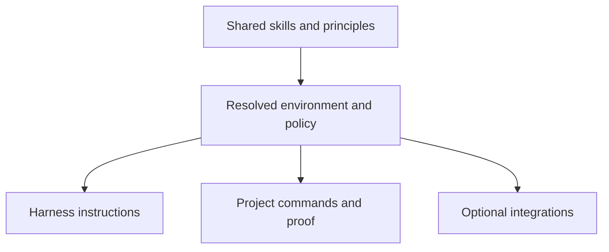

# Portability audit and improvement plan

Archived research from 2026-10-18, imported for issue #1. Repository-relative statements and counts describe the frozen source snapshots named below. Original source-file links point to the reviewed Cursor commit; this report is not an installation guide or a claim about completed roadmap work.

This copy of pstack has a reusable engineering core, but its workflows still assume a particular agent environment. The main dependencies are Cursor's tool contracts and cloud agents, Grok and Claude model identifiers, Cursor rules and transcript storage, GitHub and Origin PR workflows, and several skills that are not bundled here. Grok Bot and Benny add separate automation environments.

The recommended direction is to keep one shared set of engineering instructions, make harness integration explicit, and offer environment-specific workflows as optional packs. A useful first release should work with one local agent and its current model. Parallel agents, different model providers, cloud machines, schedulers, bots, and external services should add capabilities without becoming prerequisites for ordinary work.

## Scope and evidence

The audit covers the **171 tracked files** at local commit `933da29fe88f64e715d1a446fd1ce045b429e5ef`, whose manifests declare pstack `0.15.27`. This includes 164 text files with 15,451 lines and seven images. There are 55 main skills, including 24 principle skills, 23 playbooks, and three additional Benny skills outside the registered skill root.

The review includes instruction bodies, supporting references, examples, templates, manifests, commands, runtime dependencies, script policy, test fixtures, links, and visual assets. [The file inventory](portability-inventory.md) accounts for every tracked file and maps it to the findings below. Source locations use the audited version's line numbers.

The supplied [upstream directory](https://github.com/cursor/plugins/tree/main/pstack) provides context, but this document describes the local copy. In particular, the upstream [Claude packaging generator](https://github.com/cursor/plugins/blob/main/scripts/generate-pstack-harness-trees.mjs) lives outside `pstack/` and produces a separate harness tree. Neither that generator nor its generated tree is included here. Upstream `main` can change independently of this snapshot.

This is an audit and proposed backlog. It does not install the stack into the five harnesses, exercise cloud agents or private integrations, or change operational skills.

## Priorities

P0 means a prerequisite for a credible portable core. P1 means a substantial limitation in an affected workflow. P2 means documentation, packaging, or preference cleanup. These are implementation priorities, not vulnerability ratings.

| ID | Priority | What to tackle | First concrete improvement |
| --- | --- | --- | --- |
| F01 | P0 | Installation and discovery depend on Cursor and the upstream monorepo | Make this repository independently installable and test discovery in each harness |
| F02 | P0 | Workflows name Cursor tools and agent fields directly | Write capability-based instructions with small harness mappings |
| F03 | P0 | Grok and Claude model slugs and effort syntax are embedded throughout | Default to the current model and centralize optional role mappings |
| F04 | P0 | Configuration and activation rely on Cursor rules and metadata | Separate portable settings from harness-specific loading and invocation |
| F05 | P0 | Expected local state and skill paths come from Cursor | Resolve skill, project, state, and artifact locations explicitly |
| F06 | P1 | History-dependent skills parse Cursor transcripts | Provide transcript adapters and a summary-based fallback |
| F07 | P0 | Required skills and tools are missing from the bundle | Declare dependencies and supply portable alternatives for core steps |
| F08 | P0 | Cloud agents, background tasks, and nested delegation are assumed | Support serial execution and local isolation before cloud execution |
| F09 | P1 | Long runs assume `/loop`, wake notifications, and persistent sessions | Define bounded foreground execution and optional scheduler integration |
| F10 | P1 | Grok Bot UI is a Cursor routine and Tailscale workflow | Isolate it as an optional integration with explicit prerequisites |
| F11 | P1 | Benny installs and runs through Cursor Automations and Slack | Separate its triage logic from deployment, events, and messaging adapters |
| F12 | P1 | Forge operations assume GitHub or a nonstandard Origin CLI | Keep GitHub as an optional documented adapter and configure the forge |
| F13 | P1 | PR watcher embeds organization and bot policy | Configure approval gates and move bot recognition out of generic policy |
| F14 | P1 | Plan validation fixes the environment and verification scale | Validate declared proof requirements rather than a ten-agent template |
| F15 | P1 | Helpers require Bun and can install into the plugin on first execution | Declare a supported toolchain and make dependency preparation explicit |
| F16 | P1 | Commands mix BSD/macOS, Linux, and Unix-only behavior | Publish a platform baseline and repair incompatible command recipes |
| F17 | P0 | Workflow defaults assume broad write and publishing authority | Respect the current task's authorization and repository workflow |
| F18 | P2 | Personal engineering and communication choices are mandatory | Make the Poteto style an optional profile over shared workflows |
| F19 | P1 | Evidence sources assume particular MCPs and data conventions | Keep source categories portable and put vendor recipes behind discovery |
| F20 | P2 | Documentation and identity still describe the upstream product | Rewrite onboarding for this fork while preserving attribution |
| F21 | P0 | Tests do not establish cross-harness compatibility | Add a small compatibility suite and publish verified support levels |

## Findings

### F01 Installation and discovery need an independent distribution story

**Evidence.** `.cursor-plugin/plugin.json:29` registers `skills/` and `agents/`. The root `plugin.json:2` declares a general plugin schema, but this copy has no `.claude-plugin/plugin.json`, marketplace definition, generated Claude tree, or installation tooling. `README.md:18` advertises Cursor installation, followed by Claude marketplace commands. `README.md:30` instructs contributors to run `node scripts/generate-pstack-harness-trees.mjs` at the upstream repository root; that file is absent here.

Those marketplace commands identify upstream pstack. They do not install local Jarvis modifications. A root manifest also does not establish that each harness discovers the skills or custom agents. Merely cloning this repository leaves `skills/` outside the usual project discovery directories.

**Improve.** Choose one canonical skill tree, document project and user installation separately, and add only the packaging each supported harness needs. Preserve relative references, scripts, executable modes, and assets when installing. An installer should be idempotent, preserve local edits, and identify its source revision. Do not introduce five hand-maintained copies of every skill.

**Acceptance.** A fresh project in each supported harness can discover and invoke the fork's skills, resolve their references and helpers, and distinguish them from upstream pstack without access to the upstream monorepo.

### F02 Cursor tool names are part of the workflow contract

**Evidence.** `skills/poteto-mode/SKILL.md:95` specifies `Task`, `run_in_background`, `readonly`, and per-role `model`. `skills/swarm/SKILL.md:27` adds `generalPurpose`, `environment`, and branch-placement instructions. `skills/automate-me/SKILL.md:44` requires `AskQuestion`, followed by multiple-selection behavior. The how and review references explicitly name `Read`, `Grep`, and `Glob`. `agents/poteto-agent.md:4` uses `is_background` metadata.

Other harnesses can offer similar operations with different schemas, permissions, or lifecycle behavior. A tool-name substitution does not preserve read access, isolation, prompt inheritance, model selection, or notifications. Why and Reflect request `readonly: false` to retain MCP access even for research; another harness should select the required read capabilities rather than inherit that coupling between integration access and write authority.

**Improve.** Express the shared requirements as operations: read a file, search the repository, ask a preference question, run a scoped worker, collect its result, and stop it. Each harness guide maps those operations to tools actually available in that session. Unsupported fields must never be sent speculatively. A text question and an in-chat checklist are sufficient fallbacks for ordinary interaction.

**Acceptance.** A core workflow issues no nonexistent tool calls and completes when structured questions, custom agents, todo tools, or attachments are unavailable.

### F03 Grok model routing is a separate dependency from Grok Bot

**Evidence.** `skills/setup-pstack/SKILL.md:50` contains the role table, mostly `grok-4.7-xhigh-fast` and `claude-opus-5-5-xhigh`. The same defaults recur in `poteto-mode`, `how`, `why`, `reflect`, `swarm`, `arena`, `architect`, `interrogate`, and code playbooks. `skills/arena/SKILL.md:17` and `skills/interrogate/SKILL.md:36` group `composer-*` and `cursor-grok-*` with Grok and fall back to a Grok default. Setup modifies effort tokens inside model identifiers. `poteto-mode` also removes or adds `-fast` while choosing effort.

These are identifiers and routing conventions from the source environment. They do not establish that a model exists, is entitled, accepts that spelling, supports an effort value, or can be selected for a child in another harness. Falling back from an unavailable configured model to another unavailable hardcoded model compounds the problem. Requiring a different model family for a judge also excludes single-provider setups.

**Improve.** Default every role to the session model. Make provider, model, reasoning effort, and speed distinct optional choices, translated by the harness rather than edited as slug strings. Discover only what the active environment exposes. Keep the existing inherit-parent concept, and report a loss of model diversity honestly. Do not substitute a paid provider or run an external model CLI without the user's configuration.

**Acceptance.** Setup and the main workflow work without Grok or Claude access. A single-model review is labeled as such. Unknown models produce one clear configuration outcome rather than repeated guesses or an unsolicited PR to change defaults.

### F04 Model settings and activation are not portable metadata

**Evidence.** Setup writes `~/.cursor/rules/pstack-models.mdc` with `alwaysApply: true`; most workflow skills assume that rule is already in context. Almost all main skills carry `disable-model-invocation: true`. `poteto-mode` adds `icon` and `color`; TypeScript rules add `paths`. `docs/guide/01-setup.md:64` describes Cursor's Option+Enter or Alt+Enter Custom Mode persistence.

The Claude adapter already recognizes a real incompatibility: most skills cannot be called through Claude's `Skill` tool under the current metadata, so it instructs agents to read their files directly. That workaround needs an explicit composition policy; metadata that restricts invocation should not be treated as a generic restriction to bypass. Other harnesses use different controls for automatic activation, and a slash command need not create a persistent mode.

**Improve.** Keep shared settings in one documented, secret-free format and define precedence, for example task override, project setting, user setting, default. Separate user entry points from composable workflow references. Generate or document native activation metadata per harness. Load the active profile explicitly instead of relying on a Cursor rule. Avoid overwriting unrelated personal configuration.

**Acceptance.** A configured role is honored in a fresh session; a disabled entry point stays disabled; internal composition is explicitly supported; and the documented activation behavior survives a follow-up turn.

### F05 Skill and state paths are coupled to the host

**Evidence.** `agents/poteto-agent.md:9` searches `~/.cursor/plugins/` and selects the copy with the highest `.cursor-plugin/plugin.json` version if no path was supplied. Verification generators write to `.cursor/skills/`. Orchestrate stores data in the current agent's store, whose path is expected in the system prompt. Multi-phase plans default to that store's `docs/`. The plan skeleton uses `pstack/skills/...`, including `git show origin/main:pstack/...`.

The highest installed version may not be the version the parent invoked. A plugin cache may be read-only. The shared skills may be outside the application's Git repository, so reading them through that repository's `origin/main` cannot work. A local path passed to a cloud worker need not exist there.

**Improve.** Resolve four locations independently: the active skill bundle, the target repository, durable run state, and proof artifacts. Pass the resolved bundle root and revision to workers. Use repository-relative paths only for files actually in that repository. Store runtime state outside immutable plugin installations, and make any remote artifact transfer explicit.

**Acceptance.** The stack works when installed under an arbitrary directory, in a read-only cache, or as a dependency of a differently named repository. Workers use the parent's selected revision.

### F06 Transcript-dependent skills need an adapter and a no-history path

**Evidence.** `skills/recall/SKILL.md:15` specifies Cursor's workspace slug and nested JSONL layout. `skills/reflect/SKILL.md:15` searches three transcript layouts and identifies the active chat from `message.content[0].text`. `automate-me`, session pickup, eval, decision-trail audits, and `worktree-audit.sh:64` use the same history environment. The Claude adapter substitutes its own path encoding and assumes the newest JSONL file is the current session.

A matching extension does not mean a matching event schema. Newest-file selection is ambiguous when several sessions share a workspace. Some harnesses expose history through an API, store it remotely, omit tool events, or offer no history access. Cursor-specific paths in the reflect reviewers also determine whether a skill counts as having been used.

**Improve.** Define the minimum transcript information needed: session and workspace identity, timestamps, user/assistant messages, file reads, tool results, and parent-child relationships where available. Resolve the current session explicitly. Provide a digest or durable handoff fallback and state when tool-level evidence is unavailable. Preserve the existing prohibition on searching unrelated projects.

**Acceptance.** Recall, reflection, pickup, and trail review run against each supported transcript adapter, or return a useful limited result from supplied context without reading other projects or fabricating provenance.

### F07 The core relies on unbundled skills

**Evidence.** `README.md:258` explicitly excludes `deslop`, `control-cli`, and `control-ui`, which come from `cursor-team-kit`. `poteto-mode` and authoring flows require Cursor's built-in `create-skill`; autonomous work requires built-in `/loop`. Benny setup requires built-in `automate`. `skills/ketchup/SKILL.md:37` references `/visualize`. `skills/teach/SKILL.md:17` requires image generation for some explanations.

These are different dependency types. Some are prompt conventions, some are tooling, and some require an entire service. Installing this skill directory does not provide any of them. The guide already offers a plain-language code-cleanup fallback for `/deslop`; the core rules still name it as mandatory.

**Improve.** List required capabilities for each workflow and distinguish bundled helpers, optional skills, and external integrations. Put essential cleanup and skill-authoring guidance in the portable bundle or a short portable reference. Reuse a project's browser tests, HTTP probes, PTY driver, or other real verification harness. Make visual tooling optional when plain text or Mermaid communicates the result.

**Acceptance.** A basic investigation, feature, bug fix, or review works with no `cursor-team-kit`, Cursor built-ins, image generator, or visualization plugin. Missing proof tooling is reported as a verification gap rather than silently skipped.

### F08 Local worktrees are not equivalent to cloud machines

**Evidence.** Swarm defaults to `environment: "cloud"`. Shipping and Autopilot-full explicitly require Cursor cloud agents. Orchestrate assumes local coordinators, cloud workers, nesting to depth three, completion events, a Cursor dashboard, and cloud work surviving a local restart. The Claude adapter maps `environment: "cloud"` to `isolation: "worktree"`.

A worktree separates source files. It does not provide a separate machine, process namespace, port space, credentials, installed dependencies, display, or storage. Nor does the existence of subagents prove that they inherit the right MCP tools, may create nested children, can select another provider, or may access the same paths. Some environments have no subagents at all.

**Improve.** Support serial execution first, then bounded local workers, then stronger isolation where available. Describe what each task actually needs: separate checkout, separate process/data directory, browser profile, credentials, or remote machine. Keep authorship and review distinct where possible, and label self-review when a fresh reviewer is unavailable. Respect live concurrency limits and any session restriction on delegation.

**Acceptance.** The core completes in a single-agent environment. Parallel verification cannot share a server, data directory, or credentials accidentally. A local substitute is never described as cloud-equivalent evidence.

### F09 A Markdown loop cannot provide durable scheduling

**Evidence.** Autonomous run step 2 requires Cursor `/loop`. Babysit uses dynamic loop wakeups; Autopilot-full requires `/loop 1h`; Orchestrate relies on event-driven drains and heartbeat wakeups. The guide describes persistent Cursor Projects and work continuing while the laptop is closed. The bookkeeping CLI explicitly never spawns, waits, or wakes agents.

Background commands, in-session periodic turns, and a persistent external scheduler have different lifetimes. The bundled scripts do not supply the missing scheduler, cancellation system, or job supervisor.

**Improve.** State whether a workflow is foreground-only, session-resumable, or externally scheduled. Provide bounded iterations, deadlines, persisted checkpoints, and cancellation in the foreground path. Add scheduler integration only as an optional capability, with declared restart and laptop-sleep behavior. Do not start a daemon or promise unattended continuation merely because a skill says to loop.

**Acceptance.** Closing the session has a documented outcome. A run with no scheduler still produces a useful checkpoint. Long-lived watchers have a stop mechanism and do not outlive their authorized task.

### F10 Grok Bot UI assumes a specific Cursor automation product

**Evidence.** `skills/make-bot-ui/SKILL.md` requires all of the following:

| Location | Assumption |
| --- | --- |
| Lines 13–23 | `update_state`, target `routine`, action `create`, webhook trigger, confirmation card, and a routine folder slug |
| Lines 25–37 | An agent header, computer preview, Routines panel, `Cmd+Shift+I`, and a URL under `api2.cursor.sh/automations/webhook/` |
| Lines 39–51 | `SendToUser` with `type: secret-request` and a connector credential file |
| Lines 53–72 | A local web server, two specific authentication headers, eight-second timeout, no retry, and HTTP 200 as the wake signal |
| Lines 74–76 | A failure log the routine can drain, implying accessible storage across the UI and bot environments |
| Lines 78–104 | Tailscale, shared node identity, `0.0.0.0` binding, HTTP tailnet URLs, a shell installer, and privileged `tailscale up` |
| Lines 106–115 | `[routine]` turns and a particular `<webhook_event>` payload structure |

This is not just a dependency on the Grok model API. It is a complete bot-host, secrets, event, networking, and UI workflow. Replacing the model identifier leaves every other assumption intact. No separate Grok SDK or general Grok Bot runtime is bundled here.

**Improve.** Move this flow behind an optional Cursor/Grok Bot integration. If there is demand for a generic bot UI, define the smallest contract: create or configure an endpoint, obtain a secret through the available secret mechanism, send an authenticated event, observe delivery, and retain failures. Make networking and remote access explicit options. Default local tools to loopback; require a chosen exposure mechanism before changing the bind address. Do not carry the privileged Linux Tailscale installer into a generic setup path.

**Acceptance.** Core workflows require no Grok Bot account, Cursor routine, Tailscale installation, secret-request tool, or listening server. Enabling this optional flow verifies the actual event and credential contract and how the bot reaches any retry log.

### F11 Benny has reusable logic inside a Cursor-only deployment pack

**Evidence.** All 12 files under `automations/benny/` form a dormant pack, not registered slash skills. Setup copies it to `.cursor/automations/benny/`, changes `.cursor/settings.json`, verifies fresh project-scoped plugin loading, and uses Cursor's built-in `automate` plus an Automations editor handoff. Templates assume Slack trigger coordinates and trusted triage markers. Configuration prefers Cursor Slack actions. Reproduction requires UI driving, screenshots, recordings, media review, and a rejection window before a bounded fix.

There is already useful portability work here: configuration is external, tracker operations use an adapter contract, model slugs are placeholders rather than private defaults, feature maps are fictional examples, and the control adapter reports missing capabilities. Preserve that work. Remaining vendor commitments include Slack as transport, Cursor as host, GitHub links, and UI-only reproduction. The YAML and Markdown are instructions and examples, not a shipped general automation runtime. Event normalization also needs to be explicit: both prompt templates show `message_ts`, while operational instructions fall back to `trigger.ts` when `thread_ts` is empty. A replacement host must resolve that field contract before running the workflow.

**Improve.** Keep report classification, dedupe, source identity, ownership checks, before/after evidence, and bounded-fix rules as shared logic. Separate deployment and event delivery from chat, tracker, forge, control, secrets, and scheduling. Start with manually supplied reports if needed. Keep Slack/Cursor as one optional deployment. Add CLI or service reproduction only when a real use case needs it, rather than pretending UI recordings cover those products.

**Acceptance.** The shared triage/repro workflow can be invoked without a Cursor editor handoff. Each deployment declares its trigger schema, idempotency key, permissions, tool isolation, wait lifecycle, and artifact access. Missing isolation must continue to prevent child agents from receiving messaging credentials.

### F12 Forge and branch assumptions extend beyond the coding harness

**Evidence.** The PR watcher uses `gh`, GitHub REST/GraphQL shapes, and canonical `github.com` URLs. `watch-pr/github.ts:164` and `:192` restrict inferred remote and PR URLs to `github.com`; `render.ts:48` constructs that domain. PR playbooks opportunistically prefer an `origin` executable. Orchestrate supports exactly `gh | origin`, resolves `origin/HEAD`, and falls back to `main`. Other instructions hardcode `main`, squash merging, ordered stacks, ready PRs, and the `(#1234)` merge-message convention.

Origin is a distinct CLI, not the Git remote named `origin`. Its provenance, installation, and availability are not documented in this copy. The code already falls back to `gh` and repeatedly says Graphite `gt` is not required; Graphite should not be listed as a mandatory dependency. GitHub Enterprise host inference and rendering also need work even before adding another forge.

**Improve.** Make forge, host, remote, integration branch, PR readiness, and merge strategy project choices. Keep a no-forge local workflow. Document GitHub as the first optional forge rather than implementing every vendor immediately. Require explicit Origin selection or a validated repository configuration instead of preferring a binary just because it happens to be installed.

**Acceptance.** A repo with a different default branch or remote can use core skills. PR features use one chosen adapter throughout. A GitHub Enterprise deployment does not emit public GitHub links. No skill assumes publishing is necessary to finish local work.

### F13 PR watcher policy embeds a particular review environment

**Evidence.** `watch-pr/github.ts:250` classifies pending or action-required checks named exactly `Code Review Gate` as a distinct gate; `types.ts:91` encodes that name as a literal. Generic pending/failed CI filtering consequently treats this class differently. Tests explicitly preserve the behavior. `github.ts:329` recognizes Bugbot author strings and Cursor comment contents; `:345` extracts `RUN_ID` and `CURSOR_AUTOMATION_ID`. `policy.ts:53` recognizes review automation through check-name substrings. Babysit leans toward dismissing documented noise after the third Bugbot pass.

The watcher is read-only and does not itself merge or bypass a forge rule. Its `READY` result nevertheless has environment-specific semantics. A same-named check in another repo may mean something different. Review pass counts and prior team's dismissal patterns should not affect a finding's validity in a new project.

**Improve.** Put approval gates and automation identities in the repository's explicit review policy. Default unknown checks to their reported status. Keep approval-pending distinct from verified and merge-authorized. Treat bots as optional sources of ordinary review threads; add vendor annotations only when configured. Retain the rule to test claims against current code and preserve the existing high-risk escalation boundaries.

**Acceptance.** A repo with no Bugbot works normally. A custom check named `Code Review Gate` receives no special treatment without configuration. A passing watcher result states what was checked and does not imply missing human approval was granted.

### F14 Plan validation enforces infrastructure and cost choices

**Evidence.** `playbooks/multi-phase-plan.md:13` requires unit, live, and performance proof for every PR, ten live lanes, screenshots, and sometimes a 30–60 second video. Its skeleton requires one cloud VM per lane, `control-ui` or `control-cli`, `pstack/...` paths, `origin/main`, and `/loop 1h`. `scripts/check-plan.mjs:7` matches the phrase `Ten lanes`; `:20` requires literal program markers; `:156` validates ten numbered lanes. `check-plan.test.ts` bakes those markers into fixtures.

A person changing an API, documentation, a library, or an offline tool should not need ten cloud machines and video capture to pass a plan checker. Simply rewriting the prose would still fail the existing validator.

**Improve.** Separate the plan's structure from a project-selected verification profile. Validate scope, prerequisites, observable acceptance criteria, evidence, and justified nonapplicable checks. Let the change determine lane count, execution location, media requirements, and performance relevance. Keep strong proof where it matters; avoid making unsupported proof mechanisms disappear behind a skip.

**Acceptance.** A one-agent CLI or documentation plan passes with appropriate evidence. A behavioral change missing its declared proof fails. Tests cover different branches, bundle roots, lane counts, and projects without a live UI.

### F15 Runtime requirements and first-use installation need to be explicit

**Evidence.** Helpers live under `skills/poteto-mode/scripts/`. The orchestration entry point and watcher use Bun shebangs and `import.meta` extensions. Tests import `bun:test`. `bootstrap.ts:35` runs `bun install --frozen-lockfile` inside that scripts directory, writes an install key in its `node_modules`, and restarts the command. The plan checker runs under Node, including when launched from Bun tests. `package.json` specifies Commander but requests `latest` Bun types and TypeScript, with exact resolution captured in `bun.lock`. No root mise/tool-version configuration or runtime engine declaration is supplied. The typecheck task includes only `watch-pr/*.ts`.

A status query's first execution can therefore require network access and a writable plugin cache. Bun is not a Cursor-only tool and matches a reasonable development preference; the issue is its undeclared requirement and first-run side effects, not its presence.

**Improve.** Document the helper toolchain independently from the host application's language. Pin supported runtime versions, preferably using mise for this repository, and expose named prepare/test/check tasks. Prepare dependencies at installation or in an explicitly selected writable cache. Keep offline and read-only installations usable where possible. Extend type coverage to the actual shipped TS helpers if adopting a unified check task. Preserve the lockfile.

**Acceptance.** Helpers declare their prerequisites before work starts. A prepared install runs without network or writes to the plugin. A missing runtime produces a useful diagnostic rather than an invisible installation attempt.

### F16 Shell and operating-system recipes are inconsistent

**Evidence.** `worktree-audit.sh:108` uses BSD `stat -f '%m %N'`, followed by `date -r <epoch>`. Benchmark guidance requires Linux commands such as `nproc`, `pidstat`, and `strace`. Worktree cleanup includes Xcode `xcrun simctl`, `~/Library/...`, and Cursor caches. Bot setup uses a privileged shell installer and Tailscale daemon commands. Scratch paths use `/tmp/`; helpers use Bash shebangs and Unix utilities. Orchestration tests create fake Bash executables and mutate `PATH` with `:`. The store lock identifies its owner by a local PID (`store.ts:19`, `:375`).

There are path-handling issues beyond the OS label: worktree parsing uses `awk ... print $2`, which truncates paths containing spaces, and transcript lookup combines regex paths with unquoted `xargs stat`. A PID-only lock is suitable for a single host, not a distributed lock for several VMs sharing storage.

**Improve.** Declare macOS/Linux as an initial supported baseline if that is the intended scope; describe Windows or WSL separately. Use runtime filesystem APIs for path and timestamp handling, or tested OS branches. Obtain temporary directories from the runtime. Separate Git worktree cleanup from optional Apple simulator and Cursor cache cleanup. Keep the store explicitly local unless a real remote-state design is introduced.

**Acceptance.** Paths containing spaces work. Unsupported platform steps are detected before execution. Linux does not silently lose last-chat timestamps, macOS benchmarks do not require `nproc`, and no local PID is used as proof that a remote worker is alive or dead.

### F17 Authorization and delivery defaults must follow the target environment

**Evidence.** `poteto-mode/SKILL.md:83` permits any MCP tool and reversible external actions, including team chat and tickets, without asking. Its leaf never-block principle instead lists external messages among actions requiring confirmation. Feature and autonomous playbooks encourage commits; Opening a PR is the end of most build playbooks; automate-me ends with a commit and PR; Pause safely makes a WIP commit; Reflect files backlog issues without waiting. Opening a PR also permits hard resets between workers, whereas Benny explicitly requires draft-only PRs and no merges.

These are operating policies, not harness capabilities. A user asking for a local fix, a review, a pause, or a retrospective has not necessarily authorized publishing, ticket creation, broad skill edits, or changes to unrelated branches. Describing a read-only investigation while allowing live process hotfixes in runtime forensics is another scope ambiguity. Cleanup also assumes untracked files are disposable scratch; that classification does not establish whether another project's untracked files can be deleted.

**Improve.** Put instruction precedence and task scope above profile defaults. Separate edit, commit, push, PR creation, external messages, merge, deploy, and cleanup permissions. Honor authorization already given, without repeatedly asking. Make local validated changes a complete delivery mode. Keep out-of-scope tool and skill fixes as proposed follow-ups unless they are necessary and authorized. Label diagnostic instrumentation by its actual side effects.

**Acceptance.** An edit-only task ends with a verified local diff. Pause preserves work without an unexpected commit. A read-only request does not publish or mutate runtime state. An explicitly authorized publishing workflow still completes without redundant confirmations.

### F18 Personal style should be selectable

**Evidence.** Poteto mode mandates how/architect triggers, delegation for implementation, principle citations in replies, multiple design candidates, and a very specific writing style. Comment Sicko includes a theatrical opening and aggressive comment-deletion rules. No-comments may remove a claimed constraint even when no encoding is approved. The review quality lens treats crossing 1,000 lines as a presumptive blocker. The principles favor particular type, migration, and temporary-breakage policies. README and assets use the author's persona and branding.

These may be useful choices. They are not requirements for cross-harness operation, and several can conflict with established project conventions or a narrow task. The broad principles are substantially more portable than the orchestration around them.

**Improve.** Preserve the Poteto profile as an opt-in reference style. Give the default profile a smaller set of common expectations: understand scope, keep diffs focused, verify behavior, and state limits. Make prose, review strictness, comment policy, commit narrative, fan-out, and design ceremony project or user choices. Keep TypeScript-specific guidance scoped to TypeScript; do not impose it on every application.

**Acceptance.** A project can adopt the stack without adopting the persona, deleting valid project comments, changing code conventions, or citing principles in every answer. Names and artwork can remain as attribution or an optional theme.

### F19 Evidence integrations already have a useful abstraction boundary

**Evidence.** Why discovers seven evidence categories and reports unavailable MCPs, which is a good starting point. Its concrete recipes nevertheless name Linear, Notion, Slack, Datadog, Sentry, and Databricks tools. It assumes source control is always available through both Git and `gh`, discovers MCPs through Cursor's map or `mcps/`, and assigns one investigator per category/tool. Databricks guidance specifies dbt naming, `_timestamp`, `_id`, `properties_*`, and particular warehouse tables. Incident guidance assumes certain labels and Slack channel names. Reflect assumes a team devex tracker.

Most identifiers are already examples or placeholders, not leaked production IDs or proof of access to Lauren's organization. Slack's reference explicitly tells the reader to inspect the actual schema. Preserve those distinctions rather than classifying every vendor mention as a hard dependency.

**Improve.** Keep the generic evidence taxonomy and confidence rules. Treat vendor pages as optional recipes, selected only after tool discovery and scope resolution. Discover schemas, organizations, services, environments, and labels instead of treating examples as universal conventions. Allow local Git, CLI/API access, supplied exports, and missing-source reports. A connected write-capable MCP does not grant an investigation write authority.

**Acceptance.** Why produces an honest answer using local Git alone. Other trackers and telemetry providers can supply the same evidence categories without new core instructions. Unavailable history, auth, or retention is reported as a gap, and no backlog item is filed merely because a tracker is connected.

### F20 Onboarding and provenance need to describe this fork

**Evidence.** Both manifests identify pstack, Lauren Tan, and `cursor/plugins`. README speaks in the author's first person and recommends Cursor installation. Help turns file references into upstream `main` URLs even if the local fork differs. Guides teach Cursor menus, `/in-cloud`, Projects, `/loop`, rule files, and bot setup. The logo is persona artwork; the six guide illustrations include slash-command signage, including `/loop`. The MIT license contains Lauren's copyright notice.

**Improve.** State that Jarvis derives from pstack, identify the source revision, and document how upstream changes are incorporated. Point operational help at the installed fork revision. Replace the installation and workflow assumptions in all affected guides and examples, not only README. Keep license and attribution notices. Rebranding imagery is optional and lower priority than operational compatibility; imagery does not block execution. The local Markdown file targets checked in the audit resolve, apart from intentional code/template placeholders.

**Acceptance.** A reader can tell what is upstream, what this fork changes, what environments are supported, and which features are optional. No instruction sends them to an upstream installation while implying it contains local changes.

### F21 Existing tests protect current behavior, not portability

**Evidence.** Script tests cover local stores, GitHub parsing and watcher policy, CLI behavior, and plan syntax. Some deliberately pin environment-specific behavior, such as the special approval check and plan wording. They do not establish discovery, invocation, metadata, permission handling, model fallback, transcript parsing, artifact transfer, or scheduling across Cursor, Codex, Claude Code, Pi, and OpenCode. No CI workflow is included in this extracted repository.

**Improve.** Add a focused static check for links, skill names, referenced scripts, declared external dependencies, and accidental host-specific instructions in the portable core. Test adapters with realistic tool schemas and transcript fixtures. Add a small real smoke task for each harness and record version and execution mode. Keep unsupported optional integrations visible instead of claiming full compatibility from skill-file discovery alone.

**Acceptance.** Support is published by capability and verified version. Tests prevent a core workflow from reintroducing a required Grok slug, Cursor path, unknown tool, or undeclared cloud dependency.

## The existing Claude adapter is a starting point

`docs/harness/claude-code.md` already maps tool names, model choices, paths, and Cursor-only features. It should be preserved as evidence of prior portability work. It does not make this copy independently distributable or resolve all semantic differences.

| Current mapping or instruction | Why it needs another pass |
| --- | --- |
| Read the adapter once per session | Nothing in this copy establishes a universal bootstrap that loads it before every directly invoked skill |
| Cloud agent becomes a worktree | Source isolation does not supply a VM, separate ports, display, credentials, or remote persistence |
| Omit background and resume fields | Actual behavior depends on the active tool schema and execution mode; do not make permanent claims from one session |
| Non-Claude model becomes inherited model | Reasonable degradation, but diversity-dependent steps must disclose the change |
| Read disabled skills directly because the Skill tool refuses them | Decide supported composition and activation rather than making a refusal a general fallback instruction |
| Rule files become `CLAUDE.md` or `AGENTS.md` | Verify the harness's actual instruction discovery; arbitrary files do not acquire native semantics through a mapping table |
| Newest JSONL is the current session | Concurrent sessions require explicit identity, not just modification order |
| Skip a Cursor-only step and continue with placeholders | Safe only for optional outputs; a skipped prerequisite must block dependent work or select a real alternative |

The last issue is particularly relevant to Grok Bot: skipping routine creation and secret acquisition leaves no usable bot backend. Likewise, skipping required live proof cannot result in a verified shipping verdict.

## Proposed portable design

Keep this small. There is no need to build a universal agent runtime to share the workflows.



The shared layer defines goals, reasoning steps, scope, and evidence. Harness instructions explain native discovery, invocation, agent lifecycle, configuration, and transcripts. Project configuration supplies the target repository's checks and verification driver. Optional integrations own cloud execution, scheduling, forges, review bots, chat, trackers, observability, and networking.

Resolve capabilities once at the start of a workflow. At minimum, establish these facts when relevant:

| Area | Facts to resolve | Behavior when unavailable |
| --- | --- | --- |
| Skills | Active bundle root/revision, discovery and invocation | Explicitly read a supported workflow reference or explain installation needs |
| Model | Current model and whether overrides are supported | Inherit the current model; disclose unavailable diversity |
| Workers | Permission to delegate, concurrency, isolation, child tool access | Run serially or report a required independent-review gap |
| State | Writable durable state and artifact locations | Use an explicitly named local location; do not invent a system-provided store |
| History | Workspace/session identity and transcript access | Use supplied context or a handoff; label missing tool evidence |
| Proof | Project commands and available UI/CLI/API drivers | Use the relevant real proof or mark verification incomplete |
| Git and forge | Remote, integration branch, forge/host, delivery policy | Finish with local work when publishing is not configured or authorized |
| Background work | Session lifetime, scheduling, stop/resume | Bounded foreground work and a checkpoint |
| External services | Tools, scope, credentials, and write authorization | Report the unavailable source or integration |

Adapters should not silently grant permissions, substitute machines, start services, install runtimes, or reinterpret a missing prerequisite as success.

## Harness rollout targets

These are proposed integration targets, not claims that the current stack has passed testing. Official documentation was consulted for the discovery differences below; actual session tools remain authoritative.

| Harness | Minimal installation target | What needs special handling |
| --- | --- | --- |
| Codex | Project or user `.agents/skills/` discovery, or supported plugin distribution | Native invocation policy, AGENTS instructions, child tools/model controls, sandbox, and history access |
| Claude Code | `.claude/skills/` or a correctly packaged fork plugin | Namespaced plugin commands, skill composition, native agent fields, foreground/background behavior, and permission inheritance |
| Cursor | Existing plugin or project skill discovery | Keep Cursor-specific metadata and services in its adapter; test ordinary and cloud contexts separately |
| Pi | Its supported skill locations, including `.agents/skills/` | `/skill:name` invocation and serial operation; subagents require additional support beyond the documented core |
| OpenCode | `.opencode/skills/` or supported `.agents/skills/` discovery | Native skill loading, agent configuration, model syntax, and permissions |
| Another harness | Explicit workflow-file loading where permitted | Start with serial execution and add only verified capabilities |

Codex documents `.agents/skills/` discovery and an `agents/openai.yaml` policy for implicit invocation. Claude documents `.claude/skills/` and namespaced plugin skills. Pi documents `/skill:name`, shared `.agents/skills/` locations, and a core that omits subagents. OpenCode also documents shared `.agents/skills/` discovery. These common directories help distribution; they do not standardize the tools inside the instructions. Sources: [OpenAI skill documentation](https://learn.chatgpt.com/docs/build-skills), [Claude skills](https://code.claude.com/docs/en/skills), [Pi skills](https://github.com/badlogic/pi-mono/blob/main/packages/coding-agent/docs/skills.md), [Pi overview](https://github.com/badlogic/pi-mono/blob/main/packages/coding-agent/README.md), and [OpenCode skills](https://opencode.ai/docs/skills/).

Native metadata and child permissions need explicit verification rather than a universal schema. Relevant references are the [Agent Skills specification](https://agentskills.io/specification), [Cursor skills](https://cursor.com/help/customization/skills), and [Claude subagent documentation](https://code.claude.com/docs/en/sub-agents).

## Suggested implementation sequence

1. **Make the portable core usable locally.** Resolve installation, bundle paths, task policy, current-model defaults, and a serial path. Start with an investigation, a narrow bug fix, and a review. This addresses F01–F05, F07–F08, and F17. Verify with no Grok, no Cursor services, no cloud agents, and no external writes.
2. **Make the fork independently verifiable.** Add the small dependency/link checker and a reproducible helper toolchain. Reconcile the plan validator and review-gate policy with configurable requirements. This addresses F13–F16 and F21. Verify different repository roots, branches, and supported operating systems.
3. **Add harness integrations one at a time.** Complete and test Codex, Claude Code, Cursor, Pi, and OpenCode installation/invocation guides. Test each real execution mode rather than assuming app and CLI behavior match. Keep one source tree and publish tested limitations.
4. **Restore advanced workflows through explicit capabilities.** Add transcript adapters, bounded worker execution, proof/artifact access, and scheduler support where there is demand. This addresses F06, F08–F09, F12, and F19. Verify checkpoint/resume and missing-capability behavior.
5. **Package specialist environments separately.** Preserve Cursor/Grok Bot UI and Cursor/Slack Benny as optional packs. Generalize only their contracts that have a real second consumer. Finish onboarding, profile selection, and provenance updates. This addresses F10–F11, F18, and F20.

Each step should leave a useful stack. A migration that first adds generic vocabulary but still requires Grok, Cursor rules, and ten cloud verifiers has not reached the first milestone.

## Portability checks to add

| Scenario | Expected result |
| --- | --- |
| Only one agent and the parent model are available | Core work completes; reviewer limitations are explicit |
| No Grok model or cross-provider access | No Grok call is attempted; configured inheritance works |
| Native subagent model overrides are unavailable | Use the parent model without inventing provider credentials |
| No Cursor rules, plugins, transcripts, or built-ins | Core skills resolve from the selected installation and current context |
| Only local Git is available | Investigation works; local changes do not require a PR |
| Repo uses `develop`, another remote, or an enterprise host | Branch comparisons, URLs, and delivery follow project configuration |
| Skill bundle is outside the app repo or read-only | References resolve and helpers do not write into the plugin |
| No network after dependency preparation | Local helpers run; unavailable external evidence is reported |
| Workspace path contains spaces | Worktree, transcript, and artifact resolution remain correct |
| Several chats share the same workspace | History operations use the correct session identity |
| A required proof tool is missing | The result is incomplete or blocked, never silently verified |
| A check has the name `Code Review Gate` | No special policy applies unless configured |
| The task authorizes edits but no publishing | No commit, push, PR, message, merge, or unrelated ticket is created |
| Background execution ends or the laptop sleeps | The published lifecycle contract holds and a checkpoint survives |
| Grok Bot or Benny integration is disabled | No server, tunnel, automation, or messaging setup is attempted |

## Verification performed for this audit

The tracked-file inventory, skill/playbook counts, local references, manifests, missing monorepo tooling, command and dependency references, and seven visual assets were checked. Existing example URLs and generated Markdown placeholders were distinguished from actual broken local targets.

The following existing tests passed with Bun 1.4.3: **42 tests, zero failures**, across three files. They cover plan-checker parsing and GitHub watcher parsing/policy, including the special review gate and Bugbot cases.

```sh
bun test skills/poteto-mode/scripts/check-plan.test.ts skills/poteto-mode/scripts/watch-pr/github.test.ts skills/poteto-mode/scripts/watch-pr/policy.test.ts
```

The full helper suite and typecheck were not run. Live installation, model entitlement, cloud behavior, scheduler behavior, Origin, Grok Bot, Tailscale, and Benny integrations were not exercised. Passing the focused tests confirms existing behavior; it does not establish cross-harness support.
